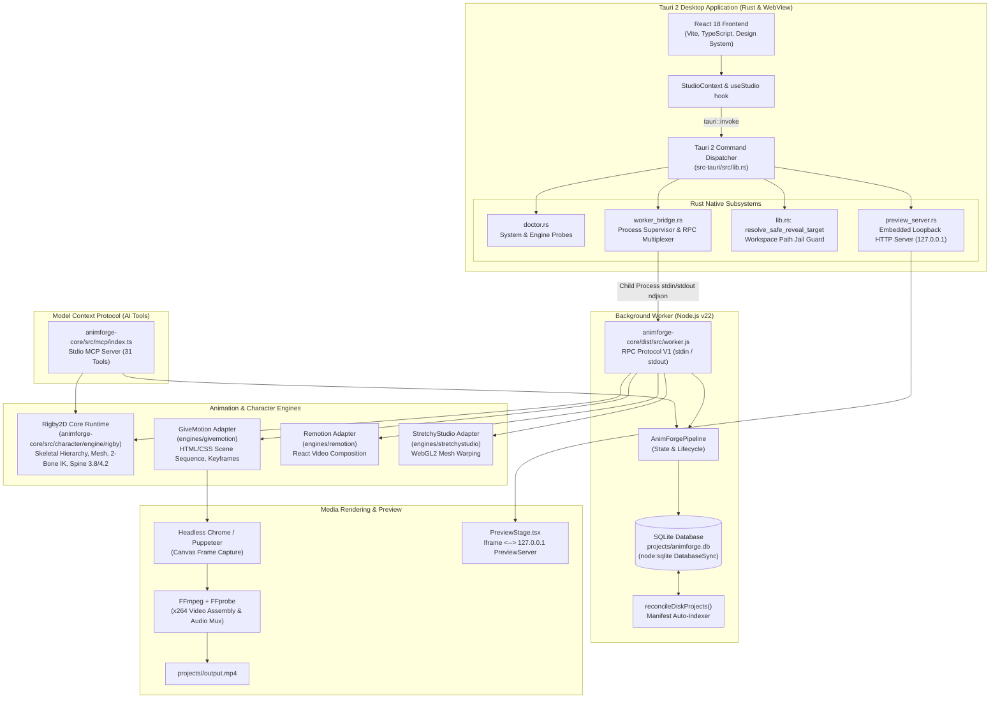

# AnimForge Studio — Complete Project Intelligence & Technical Audit

**Date:** 2026-11-14  
**Auditor:** Senior Software Architect & QA Auditor  
**Workspace:** `/Users/vipinkumar/Desktop/animator /AnimForgeLab`  
**Target Product Vision:** Single-PNG Import → Auto-Prepare → Preset Animation (Walk, Run, Dance, Jump, Wave) → Real-Time Preview → MP4/GIF Export (Beginner-friendly with hidden complexity; optional Advanced Rig Editor preserved).

---

## 1. Executive Architecture Overview

AnimForge Studio is a hybrid desktop application combining a **Tauri 2 (Rust)** desktop shell, a **React 18 + TypeScript** frontend, and a **Node.js (v22 built-in `node:sqlite`)** background orchestration worker (`animforge-core`) communicating over an asynchronous line-delimited JSON-RPC (ndjson) protocol.

### 1.1 Architecture Map & Data Flow

---

## 2. Directory Structure & Component Inventory

| Directory | Role | Status / Notes |
|-----------|------|----------------|
| `animforge-desktop/` | React 18 UI + Tauri 2 shell | **ACTIVE**: 75/75 Vitest tests pass; builds into 11MB `.app` and 3.2MB `.dmg`. |
| `animforge-desktop/src-tauri/` | Rust desktop backend | **ACTIVE**: Tauri 2, IPC router, `worker_bridge.rs`, `preview_server.rs`, `doctor.rs`. |
| `animforge-core/` | Core business logic, DB, & character engine | **ACTIVE**: 68/70 Node.js tests pass (2 skipped); handles autorig, segmentation, MCP, SQLite. |
| `engines/givemotion/` | Upstream sequencing & HTML preview engine | **INTEGRATED**: MIT license. Used for preview bundle generation and MP4 frame capture. |
| `engines/rigby2d/` | 2D Skeletal rigging & animation engine | **INTEGRATED**: Dual Apache-2.0 / MIT. Core engine compiled into `animforge-core/src/character/engine/rigby/`. |
| `engines/stretchystudio/` | WebGL2 mesh warping engine | **INTEGRATED**: MIT license. Adapter exists in core (`stretchystudio.adapter.ts`). |
| `engines/remotion/` | React programmatic video engine | **STANDALONE**: Custom commercial license (>3 staff requires fee). Adapter exists, upstream unbuilt. |
| `engines/textrig/` | Declarative rigging grammar | **REFERENCE**: MIT license. Python/Rust tool, not wired to frontend. |
| `projects/` | Unified project storage & SQLite DB | **ACTIVE**: Holds `animforge.db` + project folders (`proj_1794470257338_1` "Dancer", etc.). |
| `assets/` | Shared workspace media repository | **ACTIVE**: Subdirectories for `backgrounds`, `characters`, `props`, `audio`. |

---

## 3. Frontend Architecture

### 3.1 Technology Stack
- **Framework:** React 18.3.1 with TypeScript 5.4.5
- **Bundler:** Vite 6.4.1
- **Testing:** Vitest 2.1.9, `@testing-library/react` 16.3.2, JSDOM 24.1.0
- **Styling:** CSS variables design tokens (`--color-bg-primary`, `--color-accent`, etc.) supporting Dark, Warm Paper Light, and System themes.

### 3.2 Workspace Inventory

1. **`HomeDashboard.tsx`**: Recent project listing, quick creation from prompt, workspace diagnostics badge, quick launch actions.
2. **`ProjectManager.tsx`**: Full project grid, metadata editor (Name, prompt, dimensions, FPS, engine), project cloning/duplication, deletion with confirmation, folder reveal.
3. **`CharacterStudio.tsx`**: Dual-mode character workspace:
   - *Simple Studio Mode (Default):* High-level 5-step UI, large auto-framed puppet preview canvas, 9 visual preset animation cards, transport scrubber, duration/speed/intensity controls, Export Video dialog.
   - *Advanced Rig Editor Mode:* 3-panel professional editor (Bones list, IK constraints, slots, mesh weights, timeline, StretchyStudio schematic).
4. **`AnimationEditor.tsx`**: Multi-track scene timeline, scene sequencing, cue inspector, audio track management, camera moves.
5. **`StoryScenesWorkspace.tsx`**: Script beat generation, story structure visualizer, scene planning.
6. **`AssetLibrary.tsx`**: Asset browser with filtering (background, character, prop, audio, video), conflict resolution, drag-and-drop file upload.
7. **`RenderWorkspace.tsx`**: MP4/WebM video export settings (resolution presets, quality), real-time circular rendering progress indicator, render history with embedded video player.
8. **`DiagnosticsWorkspace.tsx`**: System health probes (Node, FFmpeg, Chrome, Rust, Engines, Disk space), one-click clipboard diagnostic report.
9. **`SettingsWorkspace.tsx`**: Theme preference, engine selection defaults, workspace path override.
10. **`AgentCenterWorkspace.tsx`**: AI agent orchestration and deterministic planning prompts.

---

## 4. Backend Architecture (Rust & Tauri 2)

### 4.1 Process Model
The desktop application does **not** embed Node.js into the Rust binary. Instead, Rust manages the native window via macOS WebKit WebView, and spawns `node animforge-core/dist/src/worker.js` as a supervised child process over `stdin`/`stdout`.

### 4.2 Security & Path Jail
`resolve_safe_reveal_target` in `src-tauri/src/lib.rs` strictly validates all file paths:
- Traversal components (`..`) are rejected.
- Hidden files (`.secret`) are rejected.
- Absolute paths escaping the workspace root are blocked.
- Symlinks pointing outside the workspace are rejected.
- Workspace paths containing trailing spaces (e.g. `animator /`) are fully preserved and normalized across platforms.

### 4.3 Preview Server (`preview_server.rs`)
An embedded HTTP/1.1 server running on `127.0.0.1` on a dynamically assigned port:
- Serves GiveMotion preview bundles (`projects/<id>/bundle/index.html`) directly into the WebView iframe.
- Implements HTTP Range requests (`bytes=start-end`) for smooth video seeking.
- Injects strict Content-Security-Policy: `frame-ancestors 'self' tauri://localhost`.
- Connection slot limiter caps simultaneous connections to prevent socket exhaustion.

---

## 5. Persistence & Database Subsystem

### 5.1 SQLite Storage (`animforge-core/src/database.ts`)
- Utilizes Node.js v22 built-in synchronous SQLite (`DatabaseSync` from `node:sqlite`).
- Database file located at `projects/animforge.db`.
- Schema:
  - `projects`: `id (PK)`, `name`, `prompt`, `data (JSON)`, `created_at`, `updated_at`.
  - `render_jobs`: `id (PK)`, `project_id`, `engine`, `status`, `progress`, `output_path`, `error`, `started_at`, `finished_at`.

### 5.2 Two-Way Disk Reconciliation (`reconcileDiskProjects`)
On every project list query, `AnimForgeDatabase` scans `projects/*/project.animforge.json`:
- If a project exists on disk but not in SQLite (e.g. created by MCP or Git), it is automatically indexed into SQLite.
- If a project file on disk has a newer modification timestamp than SQLite, the database row is updated.
- Preserves reference project `projects/proj_1794470257338_1` ("Dancer") without corruption.

---

## 6. Model Context Protocol (MCP) Subsystem

The MCP server runs over `stdio` via `animforge-mcp` (`animforge-core/dist/src/mcp/index.js`).
- Exposes **31 tools** to external AI agents (Claude, OpenCode, Antigravity):
  - **16 Project & Render Tools:** `animforge_list_projects`, `animforge_create_project`, `animforge_get_project`, `animforge_update_scene`, `animforge_export_video`, `animforge_generate_preview`, `animforge_cancel_render`, etc.
  - **15 Character Studio Tools:** `character_list`, `character_import`, `character_load`, `character_save`, `character_generate_motion`, `character_add_bone`, `character_update_bone`, `character_setup_ik`, `character_export_spine`, `character_preview`, etc.
- Validated via Zod schemas and tested end-to-end against SQLite persistence.
