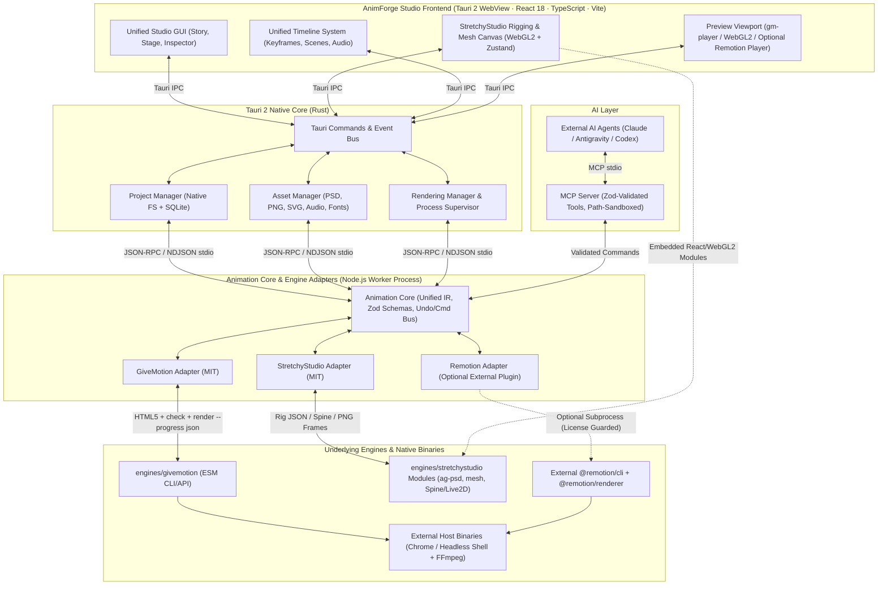

# AnimForgeLab — Repository Audit & AnimForge Studio Integration Plan

**Audit Date:** 2026-11-11  
**Workspace Root:** `/Users/vipinkumar/Desktop/animator /AnimForgeLab` *(note trailing space in parent directory name `animator `)*  
**Target Product:** **AnimForge Studio** — Unified Native Desktop Cartoon Animation Application (macOS & Linux)  
**Target Desktop Stack:** Tauri 2 · Rust · React · TypeScript · Vite

---

## Executive Summary

1. **All three upstream engines exist locally** under `AnimForgeLab/engines/` (`givemotion`, `remotion`, `stretchystudio`) as shallow git clones. **Do not reclone or overwrite them.**
2. **None of the three engines are integrated into `animforge-core` yet.** Existing `documentation/` files describe an aspirational pipeline, whereas actual inspection of `animforge-core/` reveals hardcoded demo agents (`StoryDirectorAgent`, `CharacterManagerAgent`, `ScenePlannerAgent`), a `projectId` contract bug between `AnimForgePipeline` and `GivemotionAdapter`, and stub/mock adapters for Remotion and StretchyStudio. The existing test suite (`animforge-core/test/pipeline.test.ts`) only covers schemas, hardcoded agents, and `:memory:` SQLite—zero adapter or rendering tests exist.
3. **All three engines can run independently**, with an important caveat for Remotion: `engines/remotion` is an unbuilt upstream monorepo (requiring `bun`, `turbo`, `go`, `cargo`, and lacking `node_modules`/`dist`), whereas the three Remotion test/demo projects (`projects/remotion-test`, `projects/demo-animation`, `projects/cybersecurity-explainer`) run via pre-installed npm packages (`@remotion/cli@4.0.542`, `remotion@4.0.542`).
4. **License separation is critical for a commercial desktop app:**
   - **GiveMotion** (**MIT**) and **StretchyStudio** (**MIT**) can be embedded/adapted directly in AnimForge Studio with attribution preserved.
   - **Remotion** (**Custom Source-Available License**, NOT OSI open source) restricts free commercial use to companies with ≤ 3 employees, prohibits derivative video engines, and includes telemetry/license checks (`@remotion/licensing` -> `https://www.remotion.pro`). Remotion must remain an **optional external CLI/runtime adapter** outside AnimForge Studio's bundled core.
5. **Host toolchain gap for Tauri 2:** `Node.js v24.19.0`, `npm 11.17.0`, `FFmpeg 9.0.1`, `Python 3.14.6`, `git 2.54.0`, and Google Chrome `157.0.8103.38` are present, but **`rustc`, `cargo`, `bun`, and `pnpm` are NOT installed** on the audit machine.

---

## 1. Repository Map

Inspection covered the full workspace starting from `/Users/vipinkumar/Desktop/animator /`:

```text
/Users/vipinkumar/Desktop/animator /        # Parent folder (NOTE: trailing space in folder name!)
├── .env                                    # Environment file (not read during audit)
├── .venv/                                  # Python virtual environment
└── AnimForgeLab/                           # Main workspace (no top-level .git repo)
    ├── README.md                           # Project overview, claims verified pipeline & demo
    ├── dev.sh                              # Master verification script (toolchain, core tests, doctor, MP4 ls)
    │
    ├── animforge-core/                     # TypeScript orchestration prototype (~31 MB, has node_modules + dist)
    │   ├── package.json                    # zod ^3.23.8, typescript ^5.4.5, @types/node ^20.19.43
    │   ├── tsconfig.json                   # ES2022 / NodeNext strict TS config
    │   ├── src/
    │   │   ├── index.ts                    # Barrel exports
    │   │   ├── database.ts                 # SQLite wrapper using Node built-in `node:sqlite` (DatabaseSync)
    │   │   └── pipeline.ts                 # AnimForgePipeline (has projectId mismatch with adapters)
    │   ├── schemas/                        # Zod schemas (project, scene, character, asset, storyboard, render)
    │   ├── agents/                         # Hardcoded demo agents (Pip's Glowing Door Adventure)
    │   ├── adapters/                       # adapter.interface.ts + givemotion / remotion / stretchystudio stubs
    │   ├── utils/                          # Empty directory
    │   ├── test/pipeline.test.ts           # 5 unit tests (schemas, hardcoded agents, :memory: SQLite only)
    │   └── dist/                           # Compiled JS + .d.ts output
    │
    ├── assets/                             # Shared asset directories (all 5 subdirs currently EMPTY)
    │   ├── audio/
    │   ├── backgrounds/
    │   ├── characters/
    │   ├── props/
    │   └── references/
    │
    ├── documentation/                      # Existing planning & analysis docs (pre-Tauri desktop pivot)
    │   ├── architecture.md
    │   ├── integration-plan.md             # 13-tool MCP server contract specification
    │   ├── repository-analysis.md
    │   └── setup-guide.md
    │
    ├── engines/                            # Upstream engine repositories (preserve intact)
    │   ├── givemotion/                     # 109 MB · MIT · v0.1.5 · pure ESM JS, 0 runtime npm deps
    │   ├── remotion/                       # 893 MB · Custom License · v4.0.542 monorepo (unbuilt, no node_modules)
    │   └── stretchystudio/                 # 425 MB · MIT · Vite + React 18 + WebGL2 SPA (has node_modules + dist)
    │
    └── projects/                           # Sample & test projects
        ├── givemotion-test/                # 272 KB · Standalone HTML composition + pre-rendered out.mp4 (3.5s)
        ├── remotion-test/                  # 713 MB · Remotion 4.0.542 npm install + Chrome Headless Shell + out.mp4 (3.0s)
        ├── demo-animation/                 # 30 MB · Hybrid folder: Givemotion `index.html` (12s Pip MP4)
        │                                   #         AND full Remotion React project (`LostStarMovie`, 38s MP4)
        └── cybersecurity-explainer/        # 33 MB · Remotion React project + Python audio synth (`CyberExplainer`, 56s MP4)
```

### Key Reality Check vs. Existing Documentation
- `animforge-core/agents/` (`storyDirector.ts`, `characterManager.ts`, `scenePlanner.ts`) are deterministic stubs returning the single hardcoded "Pip" 3-beat scenario regardless of prompt.
- `animforge-core/src/pipeline.ts` generates `projectId = proj_${Date.now()}` and attaches it to `scenes`, then calls `adapter.createProject(config)` which generates **its own different** `proj_${Date.now()}` / `remotion_${Date.now()}` / `stretchy_${Date.now()}` ID and discards it—so `adapter.createScene(scene)` looks up the wrong directory if run end-to-end.
- `assets/` and `animforge-core/utils/` are currently empty.
- `projects/demo-animation/` serves double duty: `index.html` + `demo-pip-adventure.mp4` is a GiveMotion composition (12.0s, 1280×720), while `src/` + `output/lost-star-final.mp4` is an unrelated Remotion composition ("The Little Robot & The Lost Star", 38.0s, 1080×1920) with `scripts/generate_audio.py`.

---

## 2. Actual Engine Locations

| Engine | Exact Path | Git Origin & HEAD | Installed Artifacts | Disk Size |
| :--- | :--- | :--- | :--- | :--- |
| **GiveMotion** | `AnimForgeLab/engines/givemotion` | `https://github.com/givemotion/givemotion` · `8aa9194` (shallow) | No `node_modules/`, no `dist/` (runs directly from `src/`) | 109 MB |
| **Remotion (Monorepo)** | `AnimForgeLab/engines/remotion` | `https://github.com/remotion-dev/remotion` · `ba0fbf0` (shallow) | No `node_modules/`, no `dist/` (unbuilt source tree) | 893 MB |
| **Remotion (Runnable NPM)** | `AnimForgeLab/projects/remotion-test/node_modules/@remotion/*` (also in `demo-animation`, `cybersecurity-explainer`) | NPM registry (`remotion@4.0.542`, `@remotion/cli@4.0.542`) | Prebuilt `dist/`, `@remotion/compositor-darwin-arm64`, `.remotion/chrome-headless-shell` | 713 MB (`remotion-test`) |
| **StretchyStudio** | `AnimForgeLab/engines/stretchystudio` | `https://github.com/MangoLion/stretchystudio` · `24a83a2` (shallow) | Full `node_modules/` and built `dist/` (includes 25 MB ONNX WASM) | 425 MB |

---

## 3. Technology Stack & Detailed Analysis of Each Engine

### 3.1 GiveMotion (`engines/givemotion`)

- **Framework & Language:** Native Node.js ESM (`"type": "module"`) in plain JavaScript with JSDoc + TypeScript declaration checking (`src/types/api.d.ts`, `tsconfig.json`). Client-side runtime is vanilla JS/CSS/Web Animations/Canvas/SVG (`src/runtime/`).
- **Entry Point & Startup Commands:**
  - CLI binary (`package.json` `"bin": "src/cli.js"`):
    - `node engines/givemotion/src/cli.js doctor` — verify Node, Chrome, FFmpeg, reproducible hardware encoder
    - `node engines/givemotion/src/cli.js dev [file.html]` — start preview studio server (`http://localhost:4400`, `src/studio/index.html`)
    - `node engines/givemotion/src/cli.js check [file.html]` — automated visual/layout/pacing QA
    - `node engines/givemotion/src/cli.js render [file.html] -o out.mp4 [--progress json] [--json]` — headless render
    - `node engines/givemotion/src/cli.js inspect|snapshot|review|still|bundle|audio|captions|words|analyze`
  - Programmatic API (`package.json` `"main": "src/api.js"`): exports `render`, `stills`, `still`, `check`, `snapshot`, `review`, `inspect`, `formatReport`, `openComposition`, `resolveInput`, `startServer`, `expandIncludes`, `injectRuntime`, `findChrome`, `installChrome`, `ensureChrome`, `FramePage`.
- **Dependencies & Installation Requirements:**
  - **Zero external npm runtime dependencies** (`devDependencies` only: `@types/node`, `typescript`).
  - **External runtime requirements:** Node.js `>= 20`, `ffmpeg` & `ffprobe` on `PATH` (or `GIVEMOTION_FFMPEG`/`GIVEMOTION_FFPROBE`), Google Chrome / `chrome-headless-shell` (found on OS or downloaded via `givemotion install`).
- **Existing Animation Capabilities:**
  - Deterministic virtual clock (`src/runtime/runtime.js`) driving CSS animations/transitions, Web Animations API, `requestAnimationFrame`, Canvas/WebGL, GSAP, and Lottie (`blocks/lottie.html`).
  - Declarative HTML sequence/motion attributes (`data-sequence`, `data-transition`, `data-camera`, `data-duration`, `data-enter`, `data-split`, `data-sketch`, `data-anchor`, `data-pulse`).
  - Built-in JS runtime (`src/runtime/motion.js`, `chart.js`, `sketch.js`, `audio.js`): GSAP-style `gm.timeline()`, camera operator (`gm.camera()`, `follow`), path travel, shape morphs, `gm.fly()`, particle bursts, beat/tempo detection (`gm.audio()`, `gm.beat()`), 21 reusable HTML blocks (`blocks/*.html`), and 7 bundled SIL OFL fonts (`Inter`, `JetBrains Mono`, `Playfair Display`, `Space Grotesk`, `Bebas Neue`, `Caveat`, `Nunito`).
- **Asset Import / Export Formats:**
  - **Import:** HTML/CSS/JS compositions, SVG, PNG/JPEG/WebP/AVIF, MP4/WebM/MOV video clips, MP3/WAV/M4A/OGG audio, `.json`/`.srt` word-timed captions, JSON `data-bind` props, Lottie JSON (via CDN `lottie-web` or local copy).
  - **Export:** `.mp4` (`h264`, `h265`/`hevc`, `av1`), `.webm` (`vp9`, alpha supported), `.mov` (ProRes `prores_ks` 4444 with `--transparent`), `.mkv`, `.gif`, PNG frame sequences, audio-only (`.mp3`, `.wav`, `.m4a`), and standalone browser bundle (`bundle` command emitting `index.html` + `gm-player.js` `<gm-player>` Web Component).
- **Rendering Capabilities:**
  - Local HTTP server + parallel headless Chrome workers (auto-budgeted by performance cores & RAM, `GIVEMOTION_MAX_BROWSERS`).
  - Linux/Windows: fast `beginFrame` capture with `chrome-headless-shell`; macOS: screenshot capture with regular Chrome (VideoToolbox tested automatically for byte reproducibility, falling back to `libx264` when non-deterministic).
  - Incremental 1–2s segment fingerprinting cache (`.gm-parts/`) re-renders only modified chunks.
  - Built-in `--progress json` NDJSON event stream on `stderr` (`open`, `frames`, `encode`, `done`, `warning`, `error`)—ready-made for a Tauri/Rust progress bridge.
- **Runs Independently?** **Yes**, out of the box with zero `npm install`.
- **API / CLI / Reusable Components:** Full Node.js ESM API (`src/api.js` + `api.d.ts`), rich CLI (`src/cli.js`), embeddable `<gm-player>` Web Component (`src/player/gm-player.js`), standalone Studio HTML (`src/studio/index.html`), and 21 HTML blocks.
- **License & Commercial Restrictions:** **MIT License** (`engines/givemotion/LICENSE`, Copyright © 2026 Leonardo Grigorio). Bundled fonts are **SIL OFL 1.1** (commercial video rendering allowed; cannot sell fonts standalone). Chrome & FFmpeg are invoked as separate external binaries under their own licenses.
- **Safe Audit Tests Executed:**
  - `node engines/givemotion/src/cli.js --version` → `0.1.5` ✅
  - `node engines/givemotion/src/cli.js doctor` (via `dev.sh`) → Node `v24.19.0`, Chrome `157.0.8103.38`, FFmpeg `9.0.1` detected; VideoToolbox auto-checked and fell back to `x264` ✅
  - `node engines/givemotion/src/cli.js blocks` → Listed all 21 blocks ✅
  - `node engines/givemotion/test/policy/independence.mjs` → `independence check: ok` ✅
  - `node --test engines/givemotion/test/unit.test.js` → **24/27 passed**; 3 loopback HTTP `fetch('127.0.0.1')` tests failed with `EPERM` solely due to terminal sandbox network restriction ⚠️
  - `node engines/givemotion/src/cli.js inspect|check projects/givemotion-test/test.html` → blocked by macOS sandbox when launching `/Applications/Google Chrome.app` (`sandbox_extension_issue_file_to_process` `Operation not permitted`); pre-rendered `projects/givemotion-test/out.mp4` verified via `ffprobe` (`h264`, 1280×720, 30 fps, 3.5s, 125 KB) ✅.

---

### 3.2 Remotion (`engines/remotion` & `projects/remotion-test`)

- **Framework & Language:** React + TypeScript monorepo (`engines/remotion`, 140+ workspace packages) with Rust native compositor (`packages/compositor`, Cargo edition 2021 using `ffmpeg-next`, `mp4`, `png`, `rayon-core`) and optional Go Lambda SDK (`go.work` Go 1.26.1).
- **Entry Point & Startup Commands:**
  - Upstream monorepo (`engines/remotion/package.json`): requires `bun >= 1.4.3`, `turbo`, `node packages/.monorepo/tsrs.cjs` (`turbo run make` / `bun check`). Currently unbuilt (no `node_modules`, no `dist/`).
  - Project runtime (`projects/remotion-test/package.json`):
    - Entry point: `src/index.ts` (`registerRoot(RemotionRoot)`) → `src/Root.tsx` (`<Composition>`)
    - Interactive preview: `npx remotion studio src/index.ts` (or `remotion preview src/index.ts`)
    - Headless render: `npx remotion render src/index.ts <CompositionId> out.mp4`
    - Still frame: `npx remotion still src/index.ts <CompositionId> out.png --frame=<n>`
- **Dependencies & Installation Requirements:**
  - Monorepo requires `bun@1.4.3`, `typescript@7.1.0-beta` (patched), `react 19.3.1`, `vite 6.4.5`, Go `1.26.1`, Rust/FFmpeg build toolchain (for compositor).
  - Prebuilt NPM consumer (`projects/remotion-test`): `remotion`, `@remotion/cli`, `react@^18.3.1`, `react-dom@^18.3.1` (~237 transitive npm packages + platform `@remotion/compositor-*` binary + downloaded `chrome-headless-shell` ≈ **713 MB** on disk).
- **Existing Animation Capabilities:**
  - Frame-deterministic React component tree driven by `useCurrentFrame()`, `useVideoConfig()`, `spring()`, `interpolate()`, `<Sequence>`, `<Series>`, `<AbsoluteFill>`.
  - Ecosystem add-ons: `@remotion/transitions`, `@remotion/paths`, `@remotion/shapes`, `@remotion/motion-blur`, `@remotion/three`, `@remotion/skia`, `@remotion/lottie`, `@remotion/rive`, `@remotion/gif`, `@remotion/captions`, `@remotion/noise`, `@remotion/media-utils`.
- **Asset Import / Export Formats:**
  - **Import:** Any browser-supported React/Web asset (SVG, PNG/JPG/WebP, GIF, MP4/WebM, MP3/WAV/AAC, fonts, Lottie, Rive, Three.js GLTF/GLB via `@remotion/three`, Whisper `.json`/SRT captions).
  - **Export:** `.mp4` (`h264`, `h265`, `av1`), `.webm` (`vp8`, `vp9`), `.mov` (ProRes), `.gif`, PNG/JPEG image sequences, audio (`mp3`, `wav`, `aac`).
- **Rendering Capabilities:**
  - `@remotion/bundler` compiles compositions with Webpack 5 (`@rspack/core` / `webpack` + `esbuild`).
  - `@remotion/renderer` drives headless Chromium + `@remotion/compositor-*` (Rust + FFmpeg) for multi-threaded frame capture, offthread `<OffthreadVideo>` decoding, and audio mixing.
  - `@remotion/web-renderer` (`Mediabunny` + WebCodecs) supports experimental in-browser export; cloud rendering via `@remotion/lambda` and `@remotion/cloudrun`.
- **Runs Independently?**
  - `engines/remotion` monorepo: **No** (not in current host state—missing `bun` and `node_modules`).
  - `projects/remotion-test` / `demo-animation` / `cybersecurity-explainer`: **Yes**, via their local `node_modules/@remotion/cli`.
- **API / CLI / Reusable Components:**
  - CLI (`@remotion/cli`: `studio`, `render`, `still`, `compositions`, `bundle`, `browser`, `benchmark`).
  - Node SSR API (`@remotion/bundler`: `bundle()`; `@remotion/renderer`: `selectComposition()`, `renderMedia()`, `renderStill()`).
  - Reusable React Embed: `@remotion/player` (`<Player>` component for React UIs), `@remotion/studio-server`.
- **License & Commercial Restrictions (HIGH RISK):**
  - **Custom Source-Available License (`engines/remotion/LICENSE.md`)** — **NOT** OSI open source.
  - Free only for individuals, non-profits, evaluation, or for-profit entities with **up to 3 employees** (total headcount). Companies with **4+ employees** must purchase a paid Company License (`remotion.pro`).
  - Explicitly forbids copying or modifying Remotion code to *"sell, rent, license, relicense, or sublicense your own derivative of Remotion."*
  - `@remotion/licensing` sends usage tracking requests (`web-render`, `cloud-render`) to `https://www.remotion.pro`.
- **Safe Audit Tests Executed:**
  - `./node_modules/.bin/remotion --version` (in `projects/remotion-test`) → `@remotion/cli 4.0.542` ✅
  - `./node_modules/.bin/remotion compositions src/index.ts` → **Webpack bundle compiled in 5.82s** ✅; Chromium WebSocket connect (`ws://127.0.0.1:49599`) blocked with `EPERM` by terminal sandbox ⚠️
  - Pre-rendered outputs verified via `ffprobe`: `projects/remotion-test/out.mp4` (`h264`, 1280×720, 30 fps, 3.0s, 32 KB), `projects/demo-animation/output/lost-star-final.mp4` (`h264`, 1080×1920, 30 fps, 38.0s, 7.5 MB), `projects/cybersecurity-explainer/output/ai-cybersecurity-explainer.mp4` (`h264`, 1080×1920, 30 fps, 56.0s, 12 MB) ✅.

---

### 3.3 StretchyStudio (`engines/stretchystudio`)

- **Framework & Language:** JavaScript (`JSX`, no TypeScript), **React 18.3.1**, **Vite 5.4.0**, **Zustand 5.0.12** + **Immer 11.1.4**, **Tailwind CSS 3.4.9** + **Radix UI** (`shadcn/ui`), custom **WebGL2** rendering pipeline (`src/renderer/`).
- **Entry Point & Startup Commands:**
  - Entry HTML/JS: `index.html` → `src/main.jsx` → `src/App.jsx` (`EditorLayout`)
  - Dev server: `npm run dev` (`vite` on `http://localhost:5173`)
  - Production build: `npm run build` (`vite build` → `dist/`)
  - Preview: `npm run preview`
  - Live2D/rig verification scripts: `node scripts/verify_physics.mjs`, `node scripts/verify_arm_cascade.mjs`, `node scripts/verify_param_groups.mjs`
- **Dependencies & Installation Requirements:**
  - ~60 runtime packages + ~13 devDependencies already installed in `engines/stretchystudio/node_modules/`.
  - Key libraries: `ag-psd` (`^30.1.0`, PSD parser), `delaunator` (`^5.1.0`, mesh triangulation), `gl-matrix` (`^3.4.4`, matrix math), `jszip` (`^3.10.1`, `.stretch`/export ZIPs), `onnxruntime-web` (`^1.24.3`, DWPose browser AI inference + **25 MB WASM** asset), `lucide-react`, `@fontsource/*`, `recharts`.
  - Network caveat: DWPose model (`dw-ll_ucoco_384.onnx`, ~50 MB) downloads on demand from HuggingFace CDN unless user uploads a local `.onnx` file.
- **Existing Animation Capabilities (verified from source—far richer than `docs/PROJECT_STATUS.md` states):**
  - Multi-layer character staging (`Staging` & `Animation` modes) with parent-child transform hierarchy, pivots, and draw-order sorting.
  - On-demand **2D Delaunay mesh generation** (`src/mesh/`), vertex brush/manual deform, **axis-weighted limb vertex skinning** (`SkeletonOverlay.jsx`), and **5×5/lattice Warp Deformers** (`WarpDeformerPanel.jsx`, `WarpLatticeOverlay.jsx`).
  - **Skeletal auto-rigging** via bounding-box heuristics or **DWPose 133-keypoint ONNX detection** (`src/io/armatureOrganizer.js`), plus automatic left/right iris-to-eyewhite stencil clipping (`scenePass.js`) and 2D iris trackpad.
  - **Parameters & Shape Keys / BlendShapes** (`parameterStore.js`, `ParametersPanel.jsx`) and **Physics rules** (`PhysicsPanel.jsx` for hair, clothing, bust, arm sway).
  - **After Effects-style Timeline** (`TimelinePanel.jsx`): per-property keyframes, easing curves (`linear`, `ease-in`, `ease-out`, `ease-both`, `stepped`, cubic bezier), loop markers, copy/paste, audio tracks (`accept="audio/*"`), and undo/redo (`undoHistory.js`).
- **Asset Import / Export Formats:**
  - **Import:** `.psd` (`ag-psd` layer extraction + character tag auto-organizer), raster images (`image/*` e.g. PNG/JPG/WebP), `.stretch` (ZIP containing `project.json` + `textures/*.png` + `audios/*`), `.onnx` (optional local DWPose weights), `audio/*`.
  - **Export (`ExportModal.jsx`):**
    - Image sequence (`PNG`, `WEBP`, `JPG`) or single frame → ZIP (`jszip`) or Folder (`window.showDirectoryPicker` File System Access API)
    - **Spine 4.0+ JSON** + `images/` ZIP (`exportSpine.js`: bones, slots, region/mesh attachments, bone/slot animation timelines)
    - **Live2D Cubism Project** (`.cmo3` / `.can3` + physics + ZIP, `src/io/live2d/cmo3writer.js`) and experimental **Live2D Runtime** (`.moc3` + `.model3.json` + `.cdi3.json` + `.motion3.json` + texture atlas ZIP)
    - `.stretch` native project ZIP & browser IndexedDB (`projectDb.js`).
  - **Missing Exports:** **No MP4, WebM, MOV, or GIF export** and **no headless Node/CLI renderer**—all rendering uses an interactive browser WebGL `<canvas>` (`captureRef.current()`).
- **Runs Independently?** **Yes**, as a Vite browser SPA (`npm run dev` / `dist/`).
- **API / CLI / Reusable Components:** No CLI or Node API; however, its React components (`EditorLayout`, `CanvasViewport`, `TimelinePanel`), Zustand stores (`useProjectStore`, `useAnimationStore`, `useEditorStore`), WebGL `ScenePass`, `importPsd`, `exportToSpine`, and `exportFrames` are cleanly modularized and reusable inside a React+Vite app.
- **License & Commercial Restrictions:** **MIT License** (`engines/stretchystudio/LICENSE`, Copyright © 2026 Nguyen Phan). Safe for commercial embedding with attribution. Note third-party runtime DWPose model licensing if shipped/fetched, and Live2D trademark clarity if advertising `.cmo3`/`.moc3` export.
- **Safe Audit Tests Executed:**
  - `vite build --outDir /tmp/stretchy-audit-dist --emptyOutDir` → **Built 1,791 modules in 3.65s** ✅ (main bundle 1.22 MB JS + 25.0 MB `ort-wasm-simd-threaded.jsep.wasm`)
  - `node scripts/verify_physics.mjs` → **ALL CHECKS PASSED** ✅
  - `node scripts/verify_arm_cascade.mjs` → **ALL PASSED** ✅
  - `node scripts/verify_param_groups.mjs` → **ALL CHECKS PASSED** ✅
  - `npm run lint` → **FAILED with 1,255 problems (1,225 errors, 30 warnings)** ❌ (mostly because `eslint.config.js` puts `ignores: ['dist']` inside the `files` block so ESLint lints `dist/assets/*.js`, plus `react/prop-types` and unused vars in `src/`).

---

## 4. Capabilities Comparison

| Dimension | GiveMotion (`0.1.5`) | Remotion (`4.0.542`) | StretchyStudio (`0.0.0`) | `animforge-core` (`0.1.0`) |
| :--- | :--- | :--- | :--- | :--- |
| **Core Paradigm** | Declarative HTML/CSS/SVG + JS virtual clock | Programmatic React JSX components (`useCurrentFrame`) | Interactive WebGL2 2D bone, mesh & warp editor | TypeScript Zod schemas + SQLite + pipeline scaffold |
| **2D Character Rigging** | Manual SVG/CSS `<g>` pivots | Manual React/SVG transforms or Rive/Lottie | **Native PSD decomposition, DWPose AI rig, bone hierarchy, vertex skinning, warp lattice, shape keys, iris clipping** | Schema (`CharacterPartSchema`) only |
| **Motion & Timeline** | Declarative `data-enter`, `gm.timeline()`, paths, morphs, `gm.fly()` | Code-driven `spring()`, `interpolate()`, `<Sequence>` | **Visual multi-track keyframe timeline, easing curves, loop range, audio tracks** | Schema (`AnimationTimelineSchema`) + hardcoded demo actions |
| **Camera & VFX** | Built-in `gm.camera()`, `follow`, 25+ transitions, particles, auto motion blur | Manual CSS/Three.js transforms, `@remotion/transitions`, `@remotion/motion-blur`, Skia, Three.js | Viewport pan/zoom only (no animated scene camera yet) | Schema (`CameraMovementSchema`) |
| **Audio & Sync** | Beat/tempo/loudness detection (`gm.audio`), volume ducking, word captions | `<Audio>`, `@remotion/media-utils`, Whisper captions, waveform viz | Audio tracks on timeline (`audios/` in `.stretch`), no beat analysis | Schema only (`audioTracks: []`) |
| **Visual QA / Diagnostics** | **Built-in `check` (overflow, contrast, occlusion, pacing), `snapshot`, `review`, `analyze`** | ESLint plugin (`@remotion/eslint-plugin`) only | None | None |
| **Headless Video Render** | **Yes** — Parallel Chrome + FFmpeg, 1–2s incremental part caching, `--progress json` | **Yes** — Chromium + Rust compositor + FFmpeg, Lambda/CloudRun | **No** — Browser WebGL canvas capture to PNG/WEBP/JPG ZIP only | Delegates to adapters (untested/incomplete) |
| **Interactive Preview UI** | Lightweight `givemotion studio` HTML + `<gm-player>` Web Component | Full Remotion Studio + embeddable `<Player>` | **Full 4-zone React+Tailwind+Radix rigging/timeline editor** | None |
| **Integration Readiness** | **High** (MIT, 0 npm deps, JSON CLI + ESM API) | **Low/Medium** (Custom license, heavy bundler/Chromium stack) | **High for UI/Rigging** (MIT, React 18+Vite matches Tauri frontend) | **Incomplete** (stubs + broken `projectId` contract) |

---

## 5. License Analysis

| Component | License | Commercial Desktop Use | Fork / Modify / Embed in Proprietary App | Key Compliance Obligations & Risks |
| :--- | :--- | :--- | :--- | :--- |
| **GiveMotion** (`engines/givemotion`) | **MIT** | Allowed (any company size) | Allowed | Preserve copyright & MIT notice + `THIRD_PARTY_NOTICES.md`. Bundled Google fonts are **SIL OFL 1.1** (safe to render into videos/bundle with app; cannot sell fonts standalone). Invoke user/system `ffmpeg` and Chrome externally to keep GPL/Chrome terms outside app binary. |
| **StretchyStudio** (`engines/stretchystudio`) | **MIT** | Allowed (any company size) | Allowed | Preserve copyright & MIT notice (`Copyright (c) 2026 Nguyen Phan`). Note: if DWPose auto-download is kept, disclose HuggingFace model source/license; verify Live2D trademark usage in UI strings ("Cubism-compatible"). |
| **Remotion** (`engines/remotion` & `@remotion/*`) | **Custom Source-Available** (`LICENSE.md`) | **Restricted:** Free ONLY for individuals, non-profits, or for-profit companies with **≤ 3 employees**. 4+ staff requires paid Company License. | **Prohibited:** Cannot copy/modify Remotion code to sell, rent, license, or sublicense a derivative video engine. | Do **NOT** bundle `engines/remotion` source or embed `@remotion/renderer` as a white-labeled core engine. Expose only as an optional external runtime plugin invoked in user-managed workspaces, clearly surfacing Remotion's license check/telemetry (`remotion.pro`). |
| **FFmpeg** (host binary) | **LGPL 2.1+ or GPL 2+** (build-dependent; Homebrew `ffmpeg 9.0.1` typically GPL because of `libx264`) | Allowed as external subprocess | Do **NOT** statically link GPL FFmpeg into Rust/Tauri binary | Spawn `ffmpeg` / `ffprobe` as external CLI subprocesses (just as GiveMotion does) rather than linking `ffmpeg-next` in Rust. |

---

## 6. Integration Feasibility

| Subsystem / Engine | Feasibility | Rationale & Technical Reality |
| :--- | :--- | :--- |
| **GiveMotion → Primary Render & Composition Engine** | **High** | MIT-licensed, zero npm dependencies, native Node ESM API + `--progress json` NDJSON stream + `check` QA + incremental caching + `<gm-player>` preview component. Runs cleanly as a child process / Node worker from Tauri 2 on both macOS and Linux. |
| **StretchyStudio → Built-in Character Rigging & Pose Studio** | **High (UI/Rig) / Medium (Video)** | Already built on **React 18 + Vite + Tailwind + Zustand**—matches Tauri 2's frontend stack directly. Its missing headless MP4 renderer is solved by exporting either **rendered transparent PNG/WebP frame sequences** (via offscreen WebGL) or **Spine 4.0 JSON / SVG bone keyframes** straight into GiveMotion's composition pipeline! Must replace browser-only `showDirectoryPicker()` and `<a download>` with Tauri `dialog`/`fs` APIs. |
| **Remotion → Optional External Power-User Exporter** | **Medium (Tech) / Low (Licensing)** | Technically works via project-scoped `@remotion/cli` or `@remotion/renderer`, as shown in `projects/remotion-test`. However, bundling Remotion creates a 700+ MB footprint, Webpack overhead, React 19 monorepo mismatches, and severe license restrictions for companies >3 people. Keep decoupled as an optional adapter. |
| **`animforge-core` → Orchestration & Core IR** | **Medium (Needs Refactor)** | Zod schemas and `AnimForgeDatabase` provide a solid seed, but `AnimForgePipeline`, hardcoded `agents/`, and all three `adapters/` must be rebuilt around real data contracts and real engine invocation before claiming integration. |
| **Tauri 2 + Rust Shell** | **High (after toolchain install)** | Tauri 2 supports macOS (WKWebView) and Linux (WebKitGTK 4.1) cleanly. Rust handles native FS access, project packaging, process supervision for Node/FFmpeg/Chrome, and system health checks; Node.js handles executing GiveMotion (and optional Remotion) without rewriting two Chrome-capture engines in Rust. |

---

## 7. Recommended Architecture

To provide **one unified desktop GUI** on macOS and Linux without duplicating frameworks or violating licenses, AnimForge Studio should use a **three-layer Tauri 2 architecture**:

1. **Unified Frontend (React 18 + TypeScript + Vite inside Tauri WebView):** Hosts the Studio workspace (Story/Prompt panel, Asset browser, StretchyStudio Character Rigging Canvas, Live Composition Preview via `<gm-player>` / WebGL stage, and Unified Timeline).
2. **Native Host Layer (Tauri 2 Rust Core):** Manages OS windows, native file dialogs, workspace path sandboxing, process lifecycle (Node worker, FFmpeg, Chrome, optional MCP server), hardware probes, and local SQLite persistence (`tauri-plugin-sql` or Rust `rusqlite`, eliminating fragile `node:sqlite` reliance).
3. **Engine Worker & Adapter Layer (Node.js ESM Sidecar communicating via JSON-RPC / NDJSON over stdio):** Hosts `animforge-core` (Animation Core, Adapters, MCP Bridge) so MIT-licensed **GiveMotion** and optional **Remotion** execute in native Node without duplicating engines in Rust.

### Subsystem Responsibilities

- **Animation Core (`animforge-core` refactored):** Owns the canonical Zod-validated **Intermediate Representation (IR)**—Projects, Characters (bones, meshes, blendShapes, pivots), Scenes, Tracks/Keyframes, Camera moves, Audio clips, and Render specs—plus scene graph validation and undo/redo command serialization.
- **Project Manager:** Manages unified project bundles on disk (e.g., `projects/<slug>/project.animforge.json`, `rigs/*.stretch`, `assets/`, `scenes/`, `renders/`) synced with SQLite index metadata; replaces StretchyStudio's IndexedDB (`projectDb.js`) and blob-download `.stretch` export with deterministic native filesystem saves via Tauri FS.
- **Asset Manager:** Imports, thumbnails, validates, and indexes PSD (`ag-psd`), PNG/WebP/SVG, audio (`WAV`/`MP3`), fonts, and Spine/Lottie assets into `project/assets/` (and shared `AnimForgeLab/assets/`), converting file URIs safely for Tauri (`convertFileSrc`) and local HTTP composition servers.
- **Timeline System:** Unifies StretchyStudio's millisecond/keyframe bone+mesh+audio tracks (`animationStore.js`) with `animforge-core`'s scene sequence, camera choreography, and transitions (`SceneSchema`). Drives both the WebGL rig viewport and `<gm-player>` composition scrubbers from a single playhead state.
- **Rendering Manager:** Single render queue in Rust + Node worker that:
  1. Bakes rigged character clips from StretchyStudio (PNG/WebP sprite sequences or Spine/SVG transforms) into scene assets,
  2. Dispatches composite scene rendering to the selected engine adapter (GiveMotion default, Remotion optional),
  3. Streams structured progress (`--progress json` / Remotion progress events) to Tauri UI events (`app.emit`), enforces CPU/browser worker caps, and handles FFmpeg muxing/transcoding.
- **GiveMotion Adapter:** Real implementation translating Animation Core scenes + baked character assets into a valid GiveMotion HTML/CSS/SVG/`gm.*` composition (`gm.camera()`, `data-sequence`, audio tracks), running `check()` for automated layout/pacing QA, `snapshot()`/`still()` for thumbnails, and `render({ onProgress })` for MP4/WebM/ProRes export.
- **StretchyStudio Adapter:** Wraps StretchyStudio's Zustand stores (`useProjectStore`, `useAnimationStore`), `importPsd`, `armatureOrganizer` (heuristic + DWPose), `ScenePass` offscreen frame capture (`captureRef`), and `exportToSpine()` so character rigging runs seamlessly inside a unified Studio tab without separate browser tabs or IndexedDB silos.
- **Remotion Adapter (Optional Plugin):** Isolated external adapter that only activates when the user configures a Remotion-enabled project directory with `@remotion/cli`/`@remotion/renderer` installed and acknowledges Remotion's license terms; translates Animation Core IR into React `<Composition>` / `<Sequence>` files and runs `remotion render` in an external Node process.
- **AI Agent / MCP Integration:** Exposes the 13 structured Zod-validated tools from `documentation/integration-plan.md` (extended for Tauri Timeline/Asset/Rig inspection) over stdio MCP or local IPC—enabling external AI agents (or an in-app assistant) to manipulate the exact same Animation Core commands with path sandboxing and zero raw shell access.

### Proposed Integration Architecture Diagram



---

## 8. Dependency Conflicts & Platform Risks

| Category | Specific Conflict / Risk Discovered | Impact | Mitigation |
| :--- | :--- | :--- | :--- |
| **Missing Host Toolchains** | `rustc`, `cargo`, `bun`, and `pnpm` are **not installed** on the machine (`node v24.19.0`, `npm 11.17.0`, `ffmpeg 9.0.1` are present). | Cannot compile Tauri 2 Rust shell or run `engines/remotion` monorepo as-is. | Install Rustup (`rustc` + `cargo`) + Tauri Linux/macOS OS deps for desktop shell; keep `npm` for workspace packages and never build `engines/remotion` monorepo from source. |
| **React 18 vs React 19** | StretchyStudio and `projects/*` use **React `18.3.1`**; `engines/remotion` monorepo catalog uses **React `19.3.1`**, Vite `6.4.5`, TS `7.1.0-beta`, Zod `4.6.7`. | Direct monorepo linking will cause React dual-instance / hook crashes and Zod v3/v4 incompatibilities. | Standardize AnimForge Studio frontend + `animforge-core` on **React `18.3.x` + Vite `5.4.x` (or `6.x` compatible) + Zod `3.23.x` + TS `5.x`**, and consume Remotion only via isolated project npm installs. |
| **Experimental `node:sqlite`** | `animforge-core/src/database.ts` imports `node:sqlite` (`DatabaseSync`) with `@types/node@^20.19.43` + `// @ts-ignore`. | Fails on Node 20.x; experimental warning/instability across Node versions on Linux/macOS. | Move authoritative project/render-job DB to Rust (`tauri-plugin-sql` / `rusqlite`) or swap Node SQLite to stable `better-sqlite3` if kept in Node. |
| **StretchyStudio ESLint Failure** | `engines/stretchystudio/eslint.config.js` places `ignores: ['dist']` inside the `files` object and lacks CJS globals/prop-type config (`npm run lint` fails with **1,255 problems**). | Blocks CI quality gates if imported verbatim. | Fix ignore block in unified frontend ESLint config; leave upstream `engines/stretchystudio` unmodified until extracted/wrapped cleanly. |
| **Browser-Only APIs in StretchyStudio** | Uses `window.showDirectoryPicker()`, `<a download>` blob links, IndexedDB (`projectDb.js`), and `onnxruntime-web` 25 MB threaded WASM. | `showDirectoryPicker` is unsupported in Tauri's macOS WKWebView and Linux WebKitGTK; `ort-wasm-simd-threaded` needs COOP/COEP headers or single-thread fallback. | Route file save/open/folder exports through Tauri `dialog` + `fs` plugins; configure single-threaded ONNX WASM fallback (`ort.env.wasm.numThreads = 1`) or move DWPose inference to native/worker if needed. |
| **macOS vs Linux Video Capture & GPU** | GiveMotion `dev.sh` observed *"VideoToolbox did not encode the same bytes twice here"* → fell back to software `libx264`; macOS Chrome uses screenshot capture vs Linux `beginFrame`; Linux headless Chrome requires `libnss3`/`libgbm`/fontconfig. | Render speeds and hardware acceleration differ across OSes; Linux AppImage/deb needs system package checks in `doctor`. | Extend `doctor` health check in Tauri Rust startup for both macOS and Linux (Chrome/headless-shell, FFmpeg, WebKitGTK/Mesa, fonts), defaulting to deterministic `libx264` when GPU repeatability fails. |
| **Workspace Path Whitespace** | Workspace parent directory `/Users/vipinkumar/Desktop/animator /` ends with a trailing space. | Unquoted shell scripts/CLI calls break path resolution. | Always quote paths in Rust `Command` / Node `spawn` (use arg arrays, never shell string interpolation like `execAsync(\`node "${path}"\`)`!). |
| **JavaScript vs TypeScript Split** | `engines/givemotion` and `engines/stretchystudio` are plain JS; `animforge-core` and target Tauri frontend are TypeScript. | Untyped state leaks across adapter/UI boundaries. | Keep upstream engines untouched; define strict TS interfaces + Zod validators at the Adapter and Tauri IPC boundary (`animforge-core` + `src-tauri`). |

---

## 9. Implementation Roadmap

1. **Phase 0 — Toolchain & Hygiene Prep**
   - Install `rustup` (`rustc` + `cargo`) + macOS Xcode CLT / Linux WebKitGTK (`libwebkit2gtk-4.1-dev`, etc.) prerequisites.
   - Replace shell-interpolated `execAsync` calls in `animforge-core` with argument-safe `execFile` / `spawn` (fixes trailing-space/injection risks).
   - Keep `engines/*` read-only reference/submodule boundaries intact.
2. **Phase 1 — Tauri 2 + React/TS/Vite Desktop Shell & Sidecar Bridge**
   - Create `animforge-desktop/` (Tauri 2 + Rust + React 18 + TypeScript + Vite).
   - Implement Rust `ProcessSupervisor` spawning `animforge-core` Node worker via JSON-RPC/NDJSON stdio + native `doctor` startup check (Node, Chrome, FFmpeg).
   - Configure Tauri native file dialogs & project storage (`Project Manager` + SQLite).
3. **Phase 2 — Real GiveMotion Integration & Render Pipeline (Milestone 1)**
   - Fix `animforge-core` `AnimForgePipeline` ↔ `GivemotionAdapter` `projectId` mismatch; emit real HTML5/SVG/CSS/`gm.*` scenes from `SceneSchema`.
   - Wire `check()` QA diagnostics, `snapshot()` thumbnails, `<gm-player>` live preview inside Tauri WebView, and `render --progress json` streaming to the Rust/UI **Rendering Manager**.
4. **Phase 3 — StretchyStudio Embedding & Character Bake Pipeline**
   - Mount StretchyStudio's React+WebGL2 rigging/mesh canvas and PSD import wizard inside a dedicated **Character Rig Studio** tab in the unified Vite app (preserving MIT attribution).
   - Replace `showDirectoryPicker` / `<a download>` / IndexedDB with Tauri FS + unified `Project Manager`.
   - Implement **StretchyStudio → GiveMotion** bridge: offscreen WebGL transparent PNG/WebP frame-sequence baking and/or Spine JSON export so rigged cartoon characters drop directly onto GiveMotion scenes.
5. **Phase 4 — Unified Timeline & Asset Manager**
   - Merge scene sequencing, camera tracks, character rig clips, and audio tracks into one shared Timeline UI + Animation Core IR.
   - Populate and index `assets/` (`characters`, `backgrounds`, `props`, `audio`, `references`).
6. **Phase 5 — Optional External Remotion Plugin**
   - Fix `RemotionAdapter` to execute only in isolated external project dirs when user enables Remotion and acknowledges its Custom License.
   - Translate Animation Core IR → React `<Composition>` / `<Sequence>` components; stream render progress cleanly.
7. **Phase 6 — AI Agent / MCP Server Integration**
   - Implement the Zod-validated MCP server specified in `documentation/integration-plan.md` inside `animforge-core`, bound to the active Tauri project workspace, plus optional in-app AI director backed by real LLM providers (replacing hardcoded `StoryDirectorAgent` / `CharacterManagerAgent` / `ScenePlannerAgent`).

---

## 10. First Integration Milestone

**Milestone 1: "Real GiveMotion Adapter + Tauri 2 Shell Vertical Slice"**

- **Objective:** Prove end-to-end desktop integration of one full engine (**GiveMotion**, MIT) inside **Tauri 2 + React + TS + Vite** with a real automated test—replacing current stubs without touching `engines/givemotion`.
- **Concrete Scope:**
  1. Refactor `animforge-core/adapters/givemotion.adapter.ts` & `src/pipeline.ts`:
     - Accept caller-supplied `projectId` deterministically in `createProject(projectId, config)`.
     - Translate `Scene` + `Character` parts/actions/camera moves into a real `index.html` GiveMotion composition (instead of `<h2>/p` placeholders).
     - Implement `preview()` to call `givemotion check --json` + `still`/`dev` URL, and `render()` to use `spawn` with `--progress json` NDJSON progress events.
  2. Add an executable integration test (`animforge-core/test/givemotion.integration.test.ts`) that creates a project, runs `GivemotionAdapter` `initialize` → `createProject` → `createScene` → `preview` (QA check) → `render`, and verifies the output `.mp4` with `ffprobe`.
  3. Initialize minimal Tauri 2 desktop app (`animforge-desktop/`) with:
     - Rust health check command (`doctor`: Node, Chrome, FFmpeg status),
     - Project open/save + Render trigger IPC bridging Node worker NDJSON progress to a React progress bar,
     - Embedded `<gm-player>` preview stage displaying a rendered/bundled GiveMotion project.
- **Exit Criteria:**
  - Clicking **Render MP4** in the Tauri desktop GUI compiles and encodes a valid H.264 MP4 from a unified `Project` JSON via `GivemotionAdapter`, shows live frame progress, passes `givemotion check`, and plays inside the unified GUI on macOS (and Linux CI/container verification).
